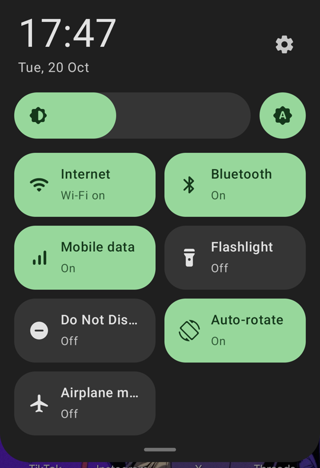

# OpenShade

A Material You quick settings shade for Android phones whose stock shade you don't like.

OpenShade draws its own panel when you swipe down from the top edge of the screen. It runs on
top of the existing system UI, so it works on stock firmware **without root and without
unlocking the bootloader**.



## Features

- Swipe down from the status bar to open, swipe up, tap outside or press Back to close
- Clock and date header with a shortcut to Settings
- Brightness slider with an adaptive-brightness toggle
- Tiles: Internet, Bluetooth, Mobile data, Flashlight, Do Not Disturb, Auto-rotate, Airplane mode
- Long-press a tile to open its settings page
- Colors follow the system Material You palette (Android 12+)

## Status

Early prototype (v0.1). Tested on an Infinix Zero 30 5G running XOS 14 (Android 14).

Android does not allow regular apps to switch Wi-Fi, Bluetooth, mobile data or airplane mode
directly, so those tiles currently open the matching system panel. Direct toggles through
[Shizuku](https://shizuku.rikka.app/) are planned.

### Roadmap

- [ ] Notifications in the panel (NotificationListenerService)
- [ ] Direct Wi-Fi / Bluetooth / mobile data toggles via Shizuku
- [ ] Two-stage panel: compact row of tiles, then the full grid
- [ ] Tile editor (reorder, add, remove)
- [ ] Palette taken directly from the wallpaper
- [ ] Media player controls

## Installation

1. Download the APK from [Releases](../../releases) and install it.
2. Open OpenShade and follow the setup steps:
   - enable the OpenShade accessibility service;
   - allow *Modify system settings* (brightness and auto-rotate);
   - allow *Do Not Disturb* access.

On Android 13 and newer, if the accessibility toggle is greyed out, open
*Settings → Apps → OpenShade → ⋮ → Allow restricted settings* first.

## Permissions

| Permission | Why |
|---|---|
| Accessibility service | Detects the swipe at the top edge and draws the panel above other apps |
| Modify system settings | Brightness slider and auto-rotate tile |
| Do Not Disturb access | Do Not Disturb tile |

OpenShade does not read screen content, has no internet permission and collects no data.

## Building

Requirements: JDK 17 and the Android SDK (platform 35).

```bash
./gradlew assembleDebug
```

The APK is written to `app/build/outputs/apk/debug/`.

## License

[GPL-3.0](LICENSE)
